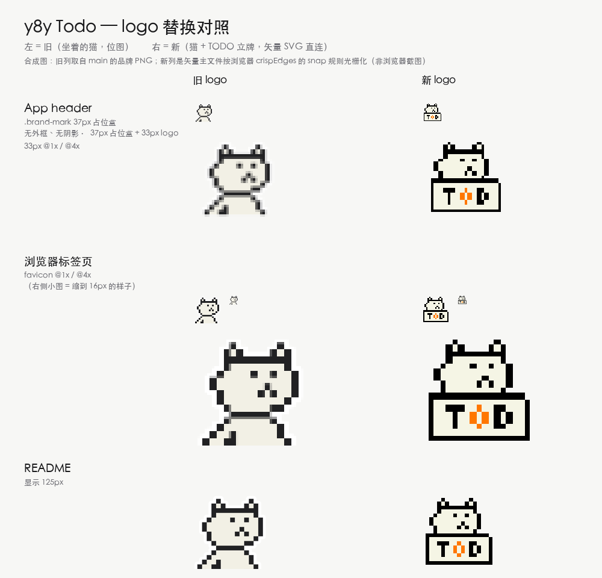

# Brand assets — logo 替换对照（2026-10-24）

官方 logo 从「坐着的猫」换成「猫 + TODO 立牌」（`y8y-logo.svg`，19×19 像素网格）。



## 这张图是什么

**合成图，不是浏览器截图。** 图里每一张 logo 都来自真实资产：

- 旧的那一列是 `main` 分支里的品牌 PNG；
- 新的那一列是**矢量主文件** `y8y-logo.svg` 按「最近邻 + 边界取整」光栅化出来的
  结果 —— 这正是浏览器用 `shape-rendering="crispEdges"` 渲染同一份 SVG 时的
  snap 规则（每个设备像素只来自一个源像素，源格仍是正方形）。

header 那格按 `header.css` 的真实几何复刻：`.brand-mark` 37px 占位盒 + 33px 内容区，
**无外框、无投影** —— logo 直接贴在 header 底上。

之所以不是浏览器截图：生成这张图的机器上 Chromium / WebKit 都起不来
（macOS 沙箱拒绝 Mach bootstrap 注册）。真机效果请看本地 `bash scripts/dev.sh`
后的 header、favicon 和 README。

## 资源清单

| 文件 | 用途 |
| --- | --- |
| `vendor/y8y-shared-chrome/brand/y8y-logo.svg` | **矢量主文件**（唯一素材，header / README / favicon 都直接用它） |
| `vendor/y8y-shared-chrome/brand/favicon-48.png` | **仅**给不认 SVG favicon 的老浏览器兜底（Safari 26 之前） |

应用直接加载 SVG，浏览器按矢量渲染 —— 任何尺寸、任何 DPR 都锐利，不需要
按尺寸预渲染位图。唯一的位图兜底由脚本从主文件生成，不要单独改：

```bash
python3 scripts/regen-brand-assets.py           # 重新生成 favicon 兜底
python3 scripts/regen-brand-assets.py --check   # 校验是否同步（CI 的门）
```

纯标准库实现，不需要 ImageMagick / Pillow / Inkscape。
`tests/test_brand_assets.py` 会逐像素比对兜底位图与主文件。

## 许可

品牌素材与软件源码分开授权 —— 见
[`BRANDING.md`](../../BRANDING.md) 与
[`vendor/y8y-shared-chrome/brand/LICENSE`](../../vendor/y8y-shared-chrome/brand/LICENSE)。
