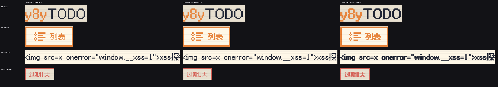
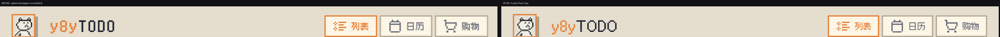
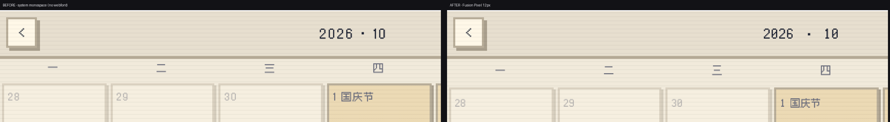
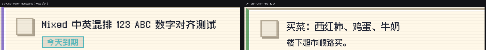
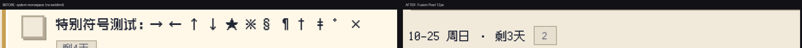
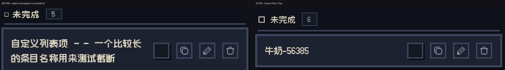

# Font migration: Zpix → Fusion Pixel (2026-10-22)

The UI font was migrated from **Zpix** to
[Fusion Pixel Font](https://github.com/TakWolf/fusion-pixel-font) (SIL OFL 1.1).

Zpix was removed during the open-source preparation pass because its
redistribution license could not be confirmed — no LICENSE/OFL file shipped
with it, and the app's `@font-face` had been broken since 2026-09-23 anyway,
so the UI had been rendering in the **system monospace** stack ever since.
Fusion Pixel replaces that fallback with a real pixel font whose license is
unambiguous.

## What ships

**One** WOFF2 face, served by the app itself (no CDN, no network access
needed at runtime) from `vendor/y8y-shared-chrome/fonts/`:

| CSS family | File | Used for |
| --- | --- | --- |
| `Fusion Pixel` | `fusion-pixel-12px-proportional-zh_hans.037fb51624ec.otf.woff2` | everything |

12 px, proportional, Simplified Chinese (`zh-Hans`) glyphs. See
`vendor/y8y-shared-chrome/fonts/SOURCES.txt` for the version, download URL
and SHA256 checksum, and `THIRD_PARTY_LICENSES.md` for the license mapping.

### Why only one file

Upstream ships every "size × width mode" in seven regional glyph variants.
fontTools confirms that for the 12 px faces:

* the Han characters have **identical advance widths** in the proportional
  and monospaced faces (both full-width, 1200/1000 em);
* the **digits have identical advance widths** too (0-9 are 600/1000 em in
  both, i.e. tabular digits) — so the calendar's day numbers and the
  date/time fields stay column-aligned on the proportional face;
* only the Latin letters differ (proportional: `i`/`l`/`.` narrower,
  `W`/`M` wider).

So the one face that the UI actually needs is the proportional one; shipping
the monospaced twin would have added ~650 KB for nothing. The 10 px face
existed to give the 10/11 px small labels a crisp 1:1 grid; dropping it means
those labels are drawn by the 12 px face scaled down (slightly softer) in
exchange for **1723 KB → 664 KB of font payload and two fewer requests**.

## Type scale

The existing 11-step scale in `tokens.css` is unchanged — a pixel font only
renders sharply at integer multiples of its native size, so the scale was
*not* rewritten (that would move the layout). 12 px is the native size and
therefore the sharpest; 13 / 14 / 16 px and the 10 / 11 px small tier are
scaled and slightly soft. That is the documented price of keeping the
existing layout; changing the scale would move every box in the UI.

## Cache busting — why the file name carries a hash

The font is served with `Cache-Control: public, max-age=31536000,
immutable`. That is only safe if a URL always means the same bytes, so the
file name carries the **SHA256 prefix of its own content**:

```
fusion-pixel-<spec>-<width>-<variant>.<sha256[:12]>.otf.woff2
```

Replacing the font therefore changes the URL, and no browser can keep
rendering the old file. The stylesheets are versioned the same way: the
`?v=` query in `src/index.html` is the SHA256 prefix of the stylesheet's own
content (`assets/tokens.css?v=0a24ffa6`), so a CSS edit can never be
shadowed by a stale cache entry and nobody has to remember to bump a number.

`tests/test_font_assets.py` enforces the whole chain: the hash in the font
file name must match the file's content, the `?v=` of every stylesheet link
must match that stylesheet's content, the preload must target the face the
body text actually uses, exactly one font file may be shipped, and a font
file *without* a content hash is denied the immutable cache (it falls back
to the ordinary 1-day policy).

## Weight — no synthetic bold

Fusion Pixel ships a single weight (400) and upstream provides no bold
resource. A `font-weight: bold` request on such a font makes the browser
**synthesize** bold: it smears the 400 outlines sideways by half a pixel,
which destroys the 12 px pixel grid.

The three options, measured in a real browser:

| | look | pixel grid |
| --- | --- | --- |
| A. synthetic bold (browser default) | strokes thickened unevenly, edges smeared | broken |
| B. `font-synthesis: none` | crisp and even, but visually lighter | intact |
| C. `font-synthesis: none` + 1 px double-strike | crisp **and** visually bold | intact |

**B is what ships** (option C was implemented and then reverted on review
feedback): `font-synthesis: none` on `:root` (inherited, supported by
Chrome 97+ / Safari 9+ / Firefox 34+) and nothing else. The existing
`font-weight: bold` declarations stay in the stylesheet — the intent is
preserved and a real bold face would light up automatically — but the glyphs
are drawn at the true 400 outlines, and hierarchy is carried by the colour,
border and size tokens the app already had.



## Symbols

Fusion Pixel has no `✓` (U+2713) and no `✗` (U+2717), and a handful of other
UI symbols (`∞`, `✦`, `‹`, `›`, `✏️`, `👁`) are not in it either. Rather than
letting those fall back to a smooth system font inside a pixel UI, they were
replaced with in-font equivalents or with the project's own pixel SVG icons:

* the completion tick is now the bundled `check.svg` icon (CSS mask, same
  mechanism as every other icon);
* toasts convert a leading `✓`/`✗` into the matching icon — the rest of the
  message is still rendered as text, never as HTML;
* `∞` → `○`, `✦` → `★`, `‹`/`›` → `◀`/`▶`.

## Character coverage — what is actually checked

`document.fonts.check()` is **not** used: it only reports whether a family is
*loaded*, never whether it *has* a glyph, so it cannot detect a missing
character. Coverage is read from the font's own `cmap` table with fontTools.

* **Application text** — every character the application itself can render
  (static markup plus the string literals in its own JavaScript) — must exist
  in the bundled font. Measured: 268 distinct characters, **0** uncovered.
* **User text** — task titles, descriptions, list and project names — is
  reported separately, not asserted: users type anything. The guarantee that
  *is* made: the face covers printable ASCII, the 3755 GB2312 level-1 hanzi
  (the common Chinese input space) and the CJK punctuation the UI uses. Rare
  or traditional characters in user text may fall back to the system stack;
  that is a documented limit, not a silent failure.
* The two characters the font genuinely lacks (`✓`, `✗`) are converted to
  icons before they reach the DOM, and the test asserts that this list of
  exceptions matches reality exactly — a *new* gap fails the test.
* `tests/browser_font_verify.py` additionally asks the renderer (Chrome
  DevTools Protocol, `CSS.getPlatformFontsForNode`) which platform font
  actually rendered a node, and how many glyphs of it.

## Visual comparison

Screenshots are taken at the same viewport, theme and DPR (2×) before and
after the migration, with identical seeded data.










